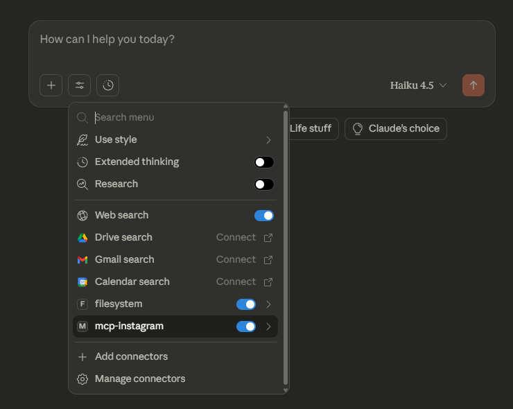
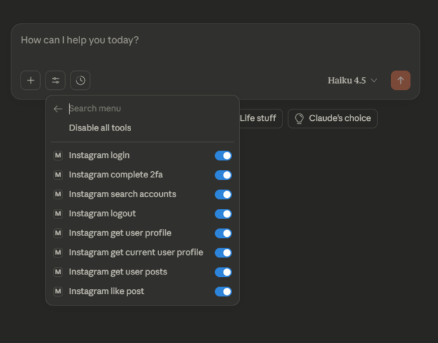

# Insta MCP Server

Servidor MCP (Model Context Protocol) para integración con Instagram.

## Características

- **Acceso Integral**: Visualiza perfiles de usuario, líneas de tiempo, historias e información detallada de publicaciones.
- **Interacción Inteligente**: Da me gusta a publicaciones y comentarios, y sigue a usuarios directamente desde tu cliente MCP.
- **Búsqueda y Descubrimiento**: Potentes capacidades de búsqueda para encontrar cuentas y explorar contenido.
- **Autenticación Segura**: Gestión robusta de inicio de sesión con soporte para autenticación de dos factores (2FA).
- **Listo para Desarrolladores**: Integración perfecta con Claude Desktop, Cursor y otras herramientas compatibles con MCP.

## Instalación para Clientes MCP

Este servidor MCP se puede usar con clientes compatibles con MCP como Claude Desktop y Cursor IDE. Siga las instrucciones a continuación para configurar el servidor en su cliente.

### Prerrequisitos

- Node.js 18+ o 20+ instalado
- Credenciales de cuenta de Instagram (`IG_USERNAME` y `IG_PASSWORD`)

### Para Claude Desktop

1. **Localice el archivo de configuración de Claude Desktop:**
   - **macOS:** `~/Library/Application Support/Claude/claude_desktop_config.json`
   - **Windows:** `%APPDATA%\Claude\claude_desktop_config.json`
   - **Linux:** `~/.config/Claude/claude_desktop_config.json`

2. **Abra el archivo de configuración** (créelo si no existe) y agregue lo siguiente en la sección `mcpServers`:

```json
{
  "mcpServers": {
    "mcp-instagram": {
      "command": "npx",
      "args": [
        "-y",
        "mcp-instagram"
      ],
      "env": {
        "IG_USERNAME": "your_instagram_username",
        "IG_PASSWORD": "your_instagram_password"
      }
    }
  }
}
```

3. **Reemplace las credenciales:**
   - Reemplace `your_instagram_username` por su nombre de usuario de Instagram
   - Reemplace `your_instagram_password` por su contraseña de Instagram

4. **Reinicie Claude Desktop** para que los cambios surtan efecto.
Y debería ver el servidor MCP de Instagram en la lista de herramientas disponibles.
<p align="center">
  
  
</p>

### Para Cursor IDE

1. **Localice el archivo de configuración MCP de Cursor:**
   - Configuración de espacio de trabajo: `.cursor/mcp.json` (en la raíz de su proyecto)
   - Configuración global: `~/.cursor/mcp.json`

2. **Abra el archivo de configuración** (créelo si no existe) y agregue lo siguiente en la sección `mcpServers`:

```json
{
  "mcpServers": {
    "mcp-instagram": {
      "command": "npx",
      "args": [
        "-y",
        "mcp-instagram"
      ],
      "env": {
        "IG_USERNAME": "your_instagram_username",
        "IG_PASSWORD": "your_instagram_password"
      }
    }
  }
}
```

3. **Reemplace las credenciales:**
   - Reemplace `your_instagram_username` por su nombre de usuario de Instagram
   - Reemplace `your_instagram_password` por su contraseña de Instagram

4. **Reinicie Cursor** para que los cambios surtan efecto.

### Alternativa: Uso de Instalación Local

Si ha clonado el repositorio localmente, puede usar la ruta absoluta en su lugar:

```json
{
  "mcpServers": {
    "mcp-instagram": {
      "command": "npx",
      "args": [
        "-y",
        "/absolute/path/to/mcp-instagram"
      ],
      "env": {
        "IG_USERNAME": "your_instagram_username",
        "IG_PASSWORD": "your_instagram_password"
      }
    }
  }
}
```

**Nota:** Reemplace `/absolute/path/to/mcp-instagram` por la ruta absoluta real de su repositorio clonado.

### Notas de Seguridad

- **Nunca envíe sus credenciales** al control de versiones
- La sección `env` en la configuración de MCP es la forma recomendada de proporcionar credenciales
- Las credenciales nunca se solicitan al LLM: deben proporcionarse mediante variables de entorno
- Si tiene la autenticación de dos factores (2FA) habilitada en su cuenta de Instagram, deberá completar el flujo de 2FA usando la herramienta `instagram_complete_2fa` después del inicio de sesión inicial

### Verificación de la Instalación

Después de reiniciar su cliente MCP, debería ver el servidor MCP de Instagram en la lista de servidores disponibles. Puede verificar que funciona pidiendo al asistente de IA que use las herramientas de Instagram como:

**Autenticación:**
- `instagram_login` - Iniciar sesión en la cuenta de Instagram
- `instagram_complete_2fa` - Completar la autenticación de dos factores
- `instagram_logout` - Cerrar sesión en Instagram

**Visualización de Perfil y Contenido:**
- `instagram_search_accounts` - Buscar cuentas de Instagram
- `instagram_get_user_profile` - Obtener información del perfil de un usuario por ID o nombre de usuario
- `instagram_get_current_user_profile` - Obtener el propio perfil del usuario autenticado
- `instagram_get_user_posts` - Obtener el feed paginado de publicaciones de un usuario
- `instagram_get_post_details` - Obtener información detallada sobre una publicación específica
- `instagram_get_user_stories` - Obtener historias activas de un usuario
- `instagram_get_timeline_feed` - Obtener el feed principal (publicaciones de cuentas que sigue)

**Acciones de Interacción:**
- `instagram_like_post` - Dar me gusta a una publicación o reel
- `instagram_like_comment` - Dar me gusta a un comentario
- `instagram_comment_on_post` - Agregar un comentario a una publicación o responder a un comentario
- `instagram_get_post_comments` - Obtener comentarios de una publicación

**Acciones Sociales:**
- `instagram_follow_user` - Seguir a un usuario de Instagram
---


## ⚠️ Descargo de Responsabilidad Legal y Riesgos

**IMPORTANTE: LEA ANTES DE USAR**

Este software utiliza métodos no oficiales de acceso a la API de Instagram y no está afiliado, respaldado ni soportado por Meta Platforms, Inc. (Instagram). Al utilizar este servidor MCP, usted reconoce y acepta lo siguiente:

### Riesgos y Limitaciones

1. **Restricciones de la Cuenta:** El uso de este software puede resultar en que su cuenta de Instagram sea señalada por actividad sospechosa o automatizada. Instagram puede emitir advertencias, restringir temporalmente la funcionalidad de la cuenta o suspenderla o eliminarla de forma permanente.

2. **Sin Garantías:** La funcionalidad de este software no está garantizada y puede dejar de funcionar en cualquier momento debido a cambios en la plataforma, medidas de seguridad o políticas de Instagram.

### Limitación de Responsabilidad

EL/LOS AUTOR(ES) Y COLABORADOR(ES) DE ESTE SOFTWARE LO PROPORCIONAN "TAL CUAL" SIN GARANTÍA DE NINGÚN TIPO, EXPRESA O IMPLÍCITA. EN NINGÚN CASO LOS AUTORES SERÁN RESPONSABLES DE NINGUNA RECLAMACIÓN, DAÑO U OTRA RESPONSABILIDAD, YA SEA EN UNA ACCIÓN CONTRACTUAL, EXTRA-CONTRACTUAL O DE OTRO TIPO, QUE SURJA DE, FUERA DE O EN CONEXIÓN CON EL SOFTWARE O EL USO DEL MISMO, INCLUYENDO PERO NO LIMITADO A:

- Suspensiones, restricciones o eliminaciones de cuentas de Instagram
- Pérdida de datos, contenido o acceso a los servicios de Instagram
- Daños directos, indirectos, incidentales, especiales, consecuenciales o punitivos

**AL USAR ESTE SOFTWARE, USTED ACEPTA LA RESPONSABILIDAD COMPLETA POR CUALQUIERA CONSECUENCIA QUE PUEDA DERIVARSE DE SU USO. ÚSELO BAJO SU PROPIO RIESGO.**

### Recomendaciones

- Use una cuenta de Instagram secundaria o de prueba en lugar de su cuenta principal
- Monitoree su cuenta en busca de advertencias o actividad inusual
- Implemente limitación de velocidad y patrones de uso razonables para minimizar el riesgo de detección
- Revise regularmente los Términos de Servicio de Instagram y cumpla con todas las leyes y regulaciones aplicables

**TL;DR:** Es simplemente sentido común. No se ponga a dar me gusta a 10,000 publicaciones en una hora ni a seguir a todo el mundo en el planeta. A Instagram no le gustan los robots que fingen ser humanos. Manténgase tranquilo, no exagere y probablemente estará bien. Probablemente.
