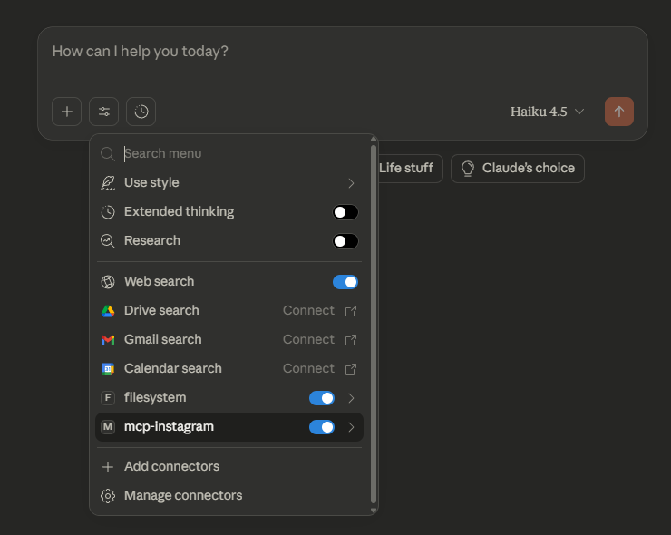
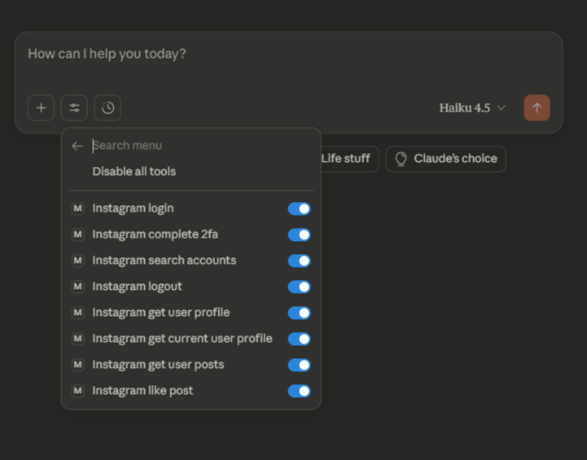

# Insta MCP Server

MCP (Model Context Protocol) server for Instagram integration.


## Features

- **Comprehensive Access**: View user profiles, timelines, stories, and detailed post information.
- **Smart Engagement**: Like posts, comments, and follow users directly from your MCP client.
- **Search & Discovery**: Powerful search capabilities to find accounts and explore content.
- **Secure Authentication**: Robust login handling with support for Two-Factor Authentication (2FA).
- **Developer Ready**: Works with Claude Code, Claude Desktop, VS Code, Cursor, and other MCP-compatible clients.

## Requirements

- Node.js 22 or newer (`node --version`). Node 20 reached end-of-life on 2026-04-30.
- An Instagram account (`IG_USERNAME` and `IG_PASSWORD`). Prefer a secondary account; see the disclaimer below.

## Installation for MCP Clients

The server runs locally over stdio and is published on npm, so every client below starts it with `npx -y mcp-instagram`.

### Claude Code

```bash
claude mcp add --env IG_USERNAME=your_username --env IG_PASSWORD=your_password --transport stdio instagram -- npx -y mcp-instagram
```

Keep `--transport stdio` between the last `--env` and the server name; otherwise the name is read as another `KEY=value` pair. Add `--scope user` to make the server available in every project.

`claude mcp add` stores the values in your Claude Code config file in plain text. To keep the password out of config files, put the server in a project `.mcp.json` and reference variables from your shell environment instead:

```json
{
  "mcpServers": {
    "instagram": {
      "command": "npx",
      "args": ["-y", "mcp-instagram"],
      "env": {
        "IG_USERNAME": "${IG_USERNAME}",
        "IG_PASSWORD": "${IG_PASSWORD}"
      }
    }
  }
}
```

### Claude Desktop

1. **Locate your Claude Desktop configuration file:**
   - **macOS:** `~/Library/Application Support/Claude/claude_desktop_config.json`
   - **Windows:** `%APPDATA%\Claude\claude_desktop_config.json`
   - **Linux:** `~/.config/Claude/claude_desktop_config.json`

2. **Open the configuration file** (create it if it doesn't exist) and add the following to the `mcpServers` section:

```json
{
  "mcpServers": {
    "mcp-instagram": {
      "command": "npx",
      "args": [
        "-y",
        "mcp-instagram"
      ],
      "env": {
        "IG_USERNAME": "your_instagram_username",
        "IG_PASSWORD": "your_instagram_password"
      }
    }
  }
}
```

3. **Replace the credentials** with your Instagram username and password.

4. **Restart Claude Desktop** for the changes to take effect.
You should then see the Instagram MCP server in the list of available tools.
<p align="center">
  
  
</p>

### VS Code

Add this to `.vscode/mcp.json` in your workspace. VS Code prompts for the username and password when the server starts and masks the password, so neither is written into the file:

```json
{
  "inputs": [
    {
      "type": "promptString",
      "id": "ig-username",
      "description": "Instagram username"
    },
    {
      "type": "promptString",
      "id": "ig-password",
      "description": "Instagram password",
      "password": true
    }
  ],
  "servers": {
    "instagram": {
      "type": "stdio",
      "command": "npx",
      "args": ["-y", "mcp-instagram"],
      "env": {
        "IG_USERNAME": "${input:ig-username}",
        "IG_PASSWORD": "${input:ig-password}"
      }
    }
  }
}
```

### Cursor

1. **Locate your Cursor MCP configuration file:**
   - Workspace config: `.cursor/mcp.json` (in your project root)
   - Global config: `~/.cursor/mcp.json`

2. **Open the configuration file** (create it if it doesn't exist) and add the following to the `mcpServers` section:

```json
{
  "mcpServers": {
    "mcp-instagram": {
      "command": "npx",
      "args": [
        "-y",
        "mcp-instagram"
      ],
      "env": {
        "IG_USERNAME": "your_instagram_username",
        "IG_PASSWORD": "your_instagram_password"
      }
    }
  }
}
```

3. **Replace the credentials** with your Instagram username and password.

4. **Restart Cursor** for the changes to take effect.

### Running from a local clone

```bash
git clone https://github.com/anand-kamble/mcp-instagram.git
cd mcp-instagram
yarn install --frozen-lockfile
yarn build
```

Then point your client at the built entry point instead of `npx`:

```json
{
  "mcpServers": {
    "mcp-instagram": {
      "command": "node",
      "args": ["/absolute/path/to/mcp-instagram/bin/insta-mcp.js"],
      "env": {
        "IG_USERNAME": "your_instagram_username",
        "IG_PASSWORD": "your_instagram_password"
      }
    }
  }
}
```

## Configuration

All configuration is through environment variables set in your MCP client's server entry.

| Variable | Required | Description |
|---|---|---|
| `IG_USERNAME` | For login | Instagram username. Every tool except login and logout needs a session, either from these credentials or a saved session. |
| `IG_PASSWORD` | For login | Instagram password. Used only for the login request; the server keeps the session cookies, not the password. |
| `IG_SESSION_DIR` | No | Directory for the saved session. Default: `$XDG_CONFIG_HOME/mcp-instagram`, else `~/.config/mcp-instagram` (macOS and Linux), or `%APPDATA%\mcp-instagram` (Windows). |
| `IG_RATE_LIMITS` | No | JSON overrides for the write-action limits, for example `{"like":{"perHour":100}}`. See [Rate limits](#rate-limits). |

### Session storage

After a successful login, the server saves the Instagram session (cookies and device identifiers) to `session.json` in the session directory above, so restarts do not require logging in again. Anyone who can read that file can act as your Instagram account, so the server creates the directory with mode `0700` and the file with mode `0600`, and writes it atomically. `instagram_logout` deletes it.

Versions up to 0.0.6 stored the session in `data/session.json` inside the package directory (under `npx`, that is the npm cache). On first start, the current version moves such a file to the new location and removes the old copy. This happens only when `IG_SESSION_DIR` is not set.

### Rate limits

Instagram restricts accounts that like, comment or follow in fast bursts. To keep an agent loop from getting the account action-blocked, the server limits write actions per process. When a limit is reached, the tool returns an error saying when to retry, and nothing is sent to Instagram.

| Action | Per minute | Per hour | Per day |
|---|---|---|---|
| like / unlike (posts and comments) | 10 | 60 | 500 |
| comment | 3 | 20 | 100 |
| follow / unfollow | 5 | 30 | 150 |

Instagram does not publish its limits, so these defaults are deliberately conservative rather than derived from Instagram's numbers. Override any subset with `IG_RATE_LIMITS`, using the keys `like`, `comment`, `follow` and `perMinute`, `perHour`, `perDay`. Counters are kept in memory and reset when the server restarts.

### Security Notes

- **Never commit your credentials** to version control. Prefer the Claude Code `${VAR}` or VS Code `inputs` setups above over plain-text passwords in config files.
- Credentials are never requested from the LLM. They come only from environment variables.
- The saved session is a credential too; see [Session storage](#session-storage).
- If your account has two-factor authentication enabled, logging in returns a 2FA prompt; complete it with the `instagram_complete_2fa` tool and the code from your authenticator app or SMS.

### Verifying Installation

After restarting your MCP client, you should see the Instagram MCP server in the list of available servers. You can verify it's working by asking the AI assistant to use Instagram tools like:

**Authentication:**
- `instagram_login` - Login to Instagram account
- `instagram_complete_2fa` - Complete two-factor authentication
- `instagram_logout` - Logout from Instagram

**Profile & Content Viewing:**
- `instagram_search_accounts` - Search for Instagram accounts
- `instagram_get_user_profile` - Get user profile information by ID or username
- `instagram_get_current_user_profile` - Get authenticated user's own profile
- `instagram_get_user_posts` - Get paginated feed of a user's posts
- `instagram_get_post_details` - Get detailed information about a specific post
- `instagram_get_user_stories` - Get active stories from a user
- `instagram_get_timeline_feed` - Get home feed (posts from accounts you follow)

**Engagement Actions:**
- `instagram_like_post` - Like a post or reel
- `instagram_like_comment` - Like a comment
- `instagram_comment_on_post` - Add a comment to a post or reply to a comment
- `instagram_get_post_comments` - Get comments for a post

**Social Actions:**
- `instagram_follow_user` - Follow an Instagram user
---


## ⚠️ Legal Disclaimer and Risks

**IMPORTANT: READ BEFORE USE**

This software utilizes unofficial Instagram API access methods and is not affiliated with, endorsed by, or supported by Meta Platforms, Inc. (Instagram). By using this MCP server, you acknowledge and agree to the following:

### Risks and Limitations

1. **Account Restrictions:** Use of this software may result in your Instagram account being flagged for suspicious or automated activity. Instagram may issue warnings, temporarily restrict account functionality, or permanently suspend or delete your account.

2. **No Guarantees:** The functionality of this software is not guaranteed and may cease to work at any time due to changes in Instagram's platform, security measures, or policies.

### Limitation of Liability

THE AUTHOR(S) AND CONTRIBUTOR(S) OF THIS SOFTWARE PROVIDE IT "AS IS" WITHOUT WARRANTY OF ANY KIND, EXPRESS OR IMPLIED. IN NO EVENT SHALL THE AUTHOR(S) BE HELD LIABLE FOR ANY CLAIM, DAMAGES, OR OTHER LIABILITY, WHETHER IN AN ACTION OF CONTRACT, TORT, OR OTHERWISE, ARISING FROM, OUT OF, OR IN CONNECTION WITH THE SOFTWARE OR THE USE OF THE SOFTWARE, INCLUDING BUT NOT LIMITED TO:

- Instagram account suspensions, restrictions, or deletions
- Loss of data, content, or access to Instagram services
- Any direct, indirect, incidental, special, consequential, or punitive damages

**BY USING THIS SOFTWARE, YOU ACCEPT FULL RESPONSIBILITY FOR ANY CONSEQUENCES THAT MAY RESULT FROM ITS USE. USE AT YOUR OWN RISK.**

### Recommendations

- Use a secondary or test Instagram account rather than your primary account
- Monitor your account for any warnings or unusual activity
- Keep the built-in [rate limits](#rate-limits) at or below their defaults to minimize detection risk
- Regularly review Instagram's Terms of Service and comply with all applicable laws and regulations

**TL;DR:** It's just common sense, really. Don't go liking 10,000 posts in an hour or following everyone on the planet. Instagram doesn't like robots pretending to be humans. Be cool, don't overdo it, and you'll probably be fine. Probably.

